  

AN EDITORIAL PROFILE · PAVANKUMAR6680

  

  

<b>Application Developer II @ Capgemini</b> · Kansas City, MO

Building enterprise backends, event-driven microservices and AI-enabled features, and sharing the work in public.

  <a href="https://pavankumar6680.github.io/space-theme-portfolio/">Portfolio</a> ·
  <a href="https://linkedin.com/in/pavan-kumar-baa364307">LinkedIn</a> ·
  <a href="mailto:pavankumaranjuri@gmail.com">Email</a>

──────── ◇ ────────

<table align="center">
  <tr>
    <td width="55%" valign="middle">
      <h1>The point of view</h1>
      <blockquote>Ship systems that stay up, scale cleanly, and make the next change easy.</blockquote>
      
3+ years across Capgemini, CBRE and Deloitte, taking Java and Spring Boot services from design to production, and now adding agentic AI and RAG on top of them.

    </td>
    <td width="45%" valign="top">
      <code>PROFILE</code>  
      ROLE · Application Developer II 
      BASED · Kansas City, MO 
      FOCUS · Java, Spring Boot &amp; GenAI  
      <b>40+</b> secured REST APIs 
      <b>90M+</b> users on a payment platform 
      <b>45%</b> faster APIs with Redis caching
    </td>
  </tr>
</table>

──────── ◇ ────────

## In the current cut

  

The ideas, experiments, and decisions moving the work forward.

──────── ◇ ────────

## Production palette

  

Java · Python · TypeScript · Spring · Kafka · React · AWS · Azure · tools chosen for the work, not the trend

──────── ◇ ────────

## The track record

<table>
  <tr>
    <td><b>Capgemini</b> Application Developer II · Jul 2025 – Present</td>
    <td>Microservices backend for an Employee Self-Service Portal: 40+ REST APIs with Spring Security, JWT and OAuth 2.0. An agentic HR and payroll assistant on LangGraph and Azure OpenAI, RAG over policy documents with Azure AI Search, plus Kafka events, Resilience4j and the Saga pattern.</td>
  </tr>
  <tr>
    <td><b>CBRE</b> Application Developer · Aug 2023 – Jul 2024</td>
    <td>30+ REST APIs and microservices on MongoDB, Spring Batch jobs processing millions of records a day, 500+ automated tests, and AWS infrastructure with Terraform, Docker and Kubernetes.</td>
  </tr>
  <tr>
    <td><b>Deloitte</b> Software Developer · May 2022 – Jul 2023</td>
    <td>REST APIs for a payment platform serving 90M+ users, with Oracle DB tuning and Redis caching that cut high-read latency by 40%.</td>
  </tr>
</table>

M.S. Computer Science · University of Central Missouri · 2025

──────── ◇ ────────

## Featured reel

  

<table>
  <tr>
    <td valign="top" width="25%"><b>Premium Threads</b>  AI-assisted fashion marketplace with a budget outfit optimizer and local Llama 3.2.  Java 21 · Spring Boot · React 19 · PostgreSQL</td>
    <td valign="top" width="25%"><a href="https://pavankumar6680.github.io/space-theme-portfolio/"><b>Space Portfolio</b></a>  Interactive 3D portfolio, the latest theme.  <a href="https://github.com/pavankumar6680/space-theme-portfolio">code</a> · HTML · Three.js</td>
    <td valign="top" width="25%"><a href="https://pavankumar6680.github.io/train-theme-portfolio/"><b>Train Portfolio</b></a>  A train-journey take on the portfolio.  <a href="https://github.com/pavankumar6680/train-theme-portfolio">code</a> · HTML · Three.js</td>
    <td valign="top" width="25%"><a href="https://pavankumar6680.github.io/"><b>Cloud Portfolio</b></a>  The original cloud-themed portfolio.  <a href="https://github.com/pavankumar6680/pavankumar6680.github.io">code</a> · HTML · Three.js</td>
  </tr>
</table>

──────── ◇ ────────

## Contribution trail

  

──────── ◇ ────────

THE NEXT SCENE

<h2 align="center">Keep the story moving</h2>

I enjoy working with people who care about the details, share the context, and ship something useful.

  

  <a href="https://linkedin.com/in/pavan-kumar-baa364307">LinkedIn</a> ·
  <a href="https://pavankumar6680.github.io/space-theme-portfolio/">Portfolio</a> ·
  <a href="mailto:pavankumaranjuri@gmail.com">pavankumaranjuri@gmail.com</a>

