<picture>
  <source media="(prefers-color-scheme: dark)" srcset="./dark.svg">
  <source media="(prefers-color-scheme: light)" srcset="./light.svg">
  
</picture>

## 👋 About

Application Developer with **3+ years of experience** across the full SDLC, building enterprise web applications with **Java 8/11/17, Spring Boot**, and **React/TypeScript**. I work on event-driven microservices with **Apache Kafka**, **Redis** caching, and deployments on **AWS** and **Azure** using Docker, Kubernetes, and CI/CD pipelines.

- 🏢 Currently: **Application Developer II @ Capgemini**
- 📍 Based in **Kansas City, MO**
- 🎯 Focus: Microservices · Event-Driven Architecture · Cloud-Native Systems
- 🌱 Currently learning: Advanced Spring Cloud patterns, Kubernetes internals, system design

## 🌐 Portfolios

Three versions of my portfolio site, each a different interactive 3D theme built with HTML, CSS and Three.js.

| Theme | Live site | Code |
|---|---|---|
| 🚀 **Space** (latest) | [pavankumar6680.github.io/space-theme-portfolio](https://pavankumar6680.github.io/space-theme-portfolio/) | [space-theme-portfolio](https://github.com/pavankumar6680/space-theme-portfolio) |
| 🚄 **Train** | [pavankumar6680.github.io/train-theme-portfolio](https://pavankumar6680.github.io/train-theme-portfolio/) | [train-theme-portfolio](https://github.com/pavankumar6680/train-theme-portfolio) |
| ☁️ **Cloud** | [pavankumar6680.github.io](https://pavankumar6680.github.io/) | [pavankumar6680.github.io](https://github.com/pavankumar6680/pavankumar6680.github.io) |

## 💼 Experience

**Application Developer II — Capgemini** *(Jul 2025 – Present)*
Microservices backend for an Employee Self-Service Portal: 40+ secured REST APIs (Spring Security, JWT, OAuth 2.0), Kafka event-driven communication, Redis caching (45% faster API responses), Resilience4j circuit breakers, Saga pattern. Azure + Docker/Kubernetes + Terraform.

**Application Developer — CBRE** *(Aug 2023 – Jul 2024)*
Enterprise Java applications and 30+ REST APIs backed by MongoDB; Spring Batch jobs processing millions of records daily for reconciliation and reporting; 500+ automated tests. AWS infrastructure with Terraform, Docker, Kubernetes.

**Software Developer — Deloitte** *(May 2022 – Jul 2023)*
REST APIs for a payment platform serving 90M+ users; Oracle DB tuning with optimized SQL, views, and stored procedures; Redis caching cut high-read endpoint latency by 40%. Deployed on AWS EC2/S3.

## 🚀 Featured Projects

- **Employee Self-Service Portal** — Microservices platform for HR, leave, attendance, and payroll modules. Java 17, Spring Boot, Spring Cloud, Kafka, Redis, MySQL.
- **Payment Platform APIs** — Backend services for a payment platform serving 90M+ users. Java 8, Spring Boot, Oracle DB, Redis.
- **High-Volume Batch Pipelines** — Spring Batch reconciliation and reporting jobs processing millions of records daily. Spring Batch, MongoDB, AWS.

## 🛠️ Engineering Stack

- **Languages:** Java 8/11/17, JavaScript, TypeScript, SQL, HTML
- **Backend:** Spring Boot, Spring MVC, Spring Security, Spring Cloud, Spring Batch, Hibernate, JPA, REST APIs, Resilience4j, Saga Pattern, JWT, OAuth 2.0
- **Frontend:** React, TypeScript, Tailwind CSS
- **Messaging:** Apache Kafka, Event-Driven Architecture
- **Databases:** MySQL, Oracle DB, SQL Server, MongoDB, Redis
- **Cloud & DevOps:** AWS (EC2, S3, CloudWatch), Microsoft Azure, Docker, Kubernetes, Terraform, CI/CD, Maven
- **Testing:** JUnit, Mockito
- **Monitoring:** Dynatrace, Grafana, Splunk, ELK Stack

## 📊 GitHub Stats

<h2 align="center">📊 GitHub Contributions</h2>

  <picture>
    <source media="(prefers-color-scheme: dark)" srcset="https://raw.githubusercontent.com/pavankumar6680/github-snake/output/github-snake-dark.svg" />
    <source media="(prefers-color-scheme: light)" srcset="https://raw.githubusercontent.com/pavankumar6680/github-snake/output/github-snake.svg" />
    
  </picture>

## 📫 Connect With Me

- 💼 LinkedIn: [linkedin.com/in/pavan-kumar-baa364307](https://linkedin.com/in/pavan-kumar-baa364307)
- 🌐 Portfolio: [pavankumar6680.github.io/space-theme-portfolio](https://pavankumar6680.github.io/space-theme-portfolio/) (see all themes under [Portfolios](#-portfolios))
- 📧 Email: pavankumaranjuri@gmail.com

---

<!-- Proudly created with GPRM ( https://gprm.itsvg.in ) -->
